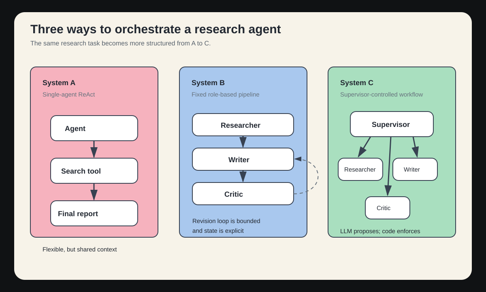
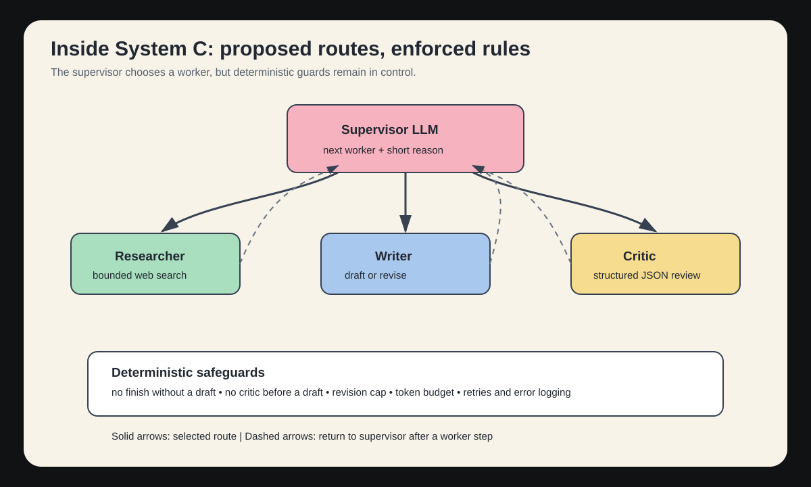
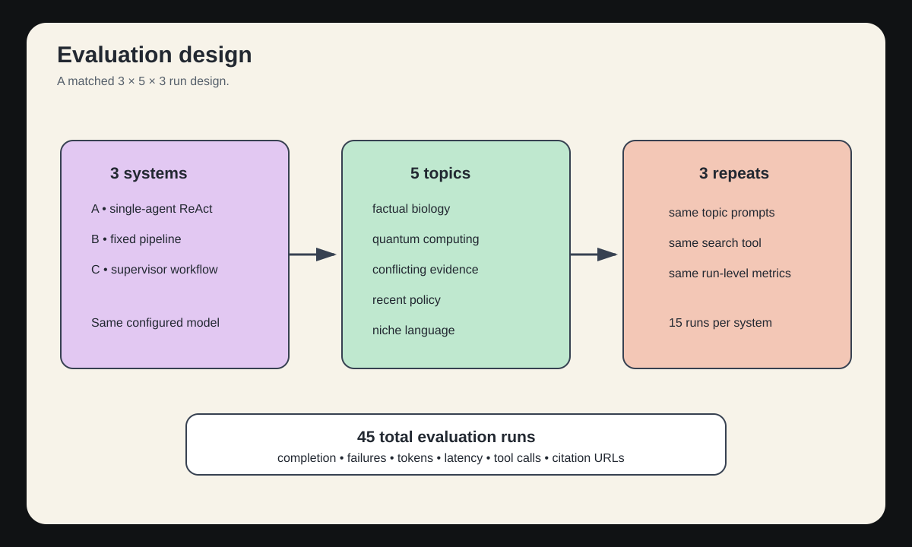
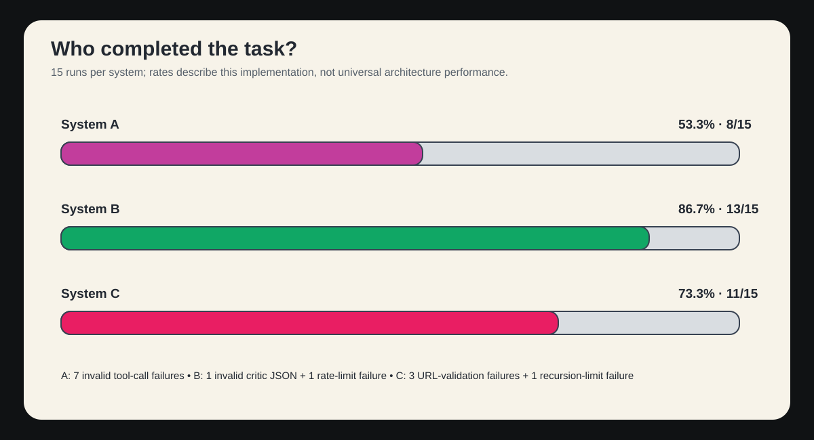
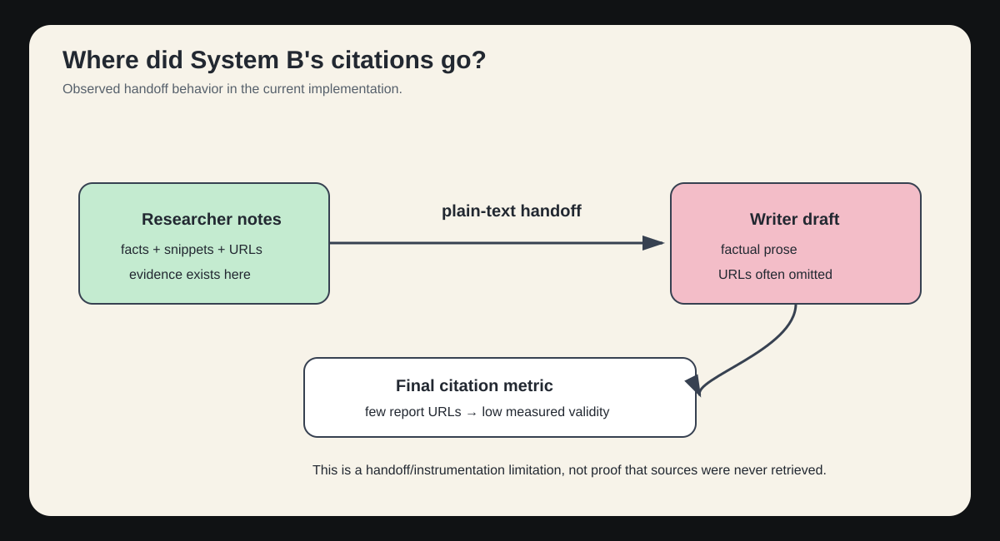

# Research Team Agents

An experimental LangGraph project for studying how different orchestration
patterns affect LLM-based research workflows.

The project compares three systems:

1. **System A — single-agent ReAct:** one agent searches, reasons, and writes.
2. **System B — fixed role pipeline:** researcher -> writer -> critic, with a
   bounded revision loop.
3. **System C — supervisor workflow:** a supervisor selects the next worker and
   deterministic guards enforce valid transitions and budgets.

The purpose is not to claim that more agents are automatically better. The
project asks a more practical question:

> Does additional orchestration improve reliability and evidence handling
> enough to justify its extra latency, token usage, and complexity?

## Architecture



### System A: single-agent ReAct

System A uses a LangGraph loop containing:

- an LLM node,
- a web-search tool node,
- conditional routing,
- a bounded search budget,
- corrective retries for malformed tool calls,
- a final report synthesis node,
- URL extraction and citation-validity metrics.

This design is flexible, but tool calls, search results, retry messages, and
writing instructions share one conversational history.

### System B: fixed role-based pipeline

System B separates the workflow into:

```text
researcher -> writer -> critic
                  ^       |
                  |-------|
                   revision loop
```

The researcher gathers notes, the writer creates or revises a draft, and the
critic evaluates accuracy, specificity, and clarity using structured JSON.
The workflow is easier to inspect than System A, but it is deterministic:
the same stages are expected for every topic.

### System C: supervisor-controlled workflow

System C places a supervisor above the same researcher, writer, and critic
roles. The supervisor proposes the next worker using structured output. The
program then enforces safeguards such as:

- no finish before a draft exists;
- no critic call before a draft exists;
- no repeated research after notes already exist;
- a maximum revision count;
- a per-run token budget;
- retry handling for retryable failures;
- validation of researcher output and URLs;
- explicit error and route logging.



The supervisor proposes a route, but the application remains responsible for
enforcing the workflow rules.

## Experimental setup

The benchmark uses five fixed topics and three runs per topic:

1. Photosystem II in oxygenic photosynthesis.
2. Quantum-computing architectures in 2026.
3. Conflicting evidence about caffeine and cardiovascular outcomes.
4. Recent global semiconductor trade policies.
5. The development and dialectal features of the Elfdalian language.

This produces 15 runs per system and 45 runs overall.



### Software and model configuration

The recorded evaluation used:

- Python 3.12.3;
- LangGraph 0.2.70;
- LangChain Core 0.3.36;
- LangChain Groq 0.2.4;
- DuckDuckGo Search 7.3.0;
- Pydantic 2.14.1;
- Groq model `openai/gpt-oss-20b`.

Temperature settings vary by role:

- System A: 0.0 normally and 0.3 for its retry model;
- System B: researcher 0.0, writer 0.7, critic 0.0;
- System C: supervisor 0.0 and the same worker temperatures as System B.

The search tool uses DuckDuckGo through `DDGS`. Each search returns up to
three results and stores successful results in a local cache. Formatted search
payloads are truncated to approximately 2,500 characters.

Workflow limits include:

- System A: four search-tool executions and LangGraph recursion limit 20;
- System B: three researcher tool iterations and two revisions;
- System C: two revisions, 20,000 tokens per run, recursion limit 20, three
  researcher notes per pass, and up to three retry attempts.

These are implementation settings for this experiment, not universal
recommended values.

## Results

The raw benchmark records are stored in `eval_results/metrics_summary.csv`
when a benchmark has been run. The current run-level results are:

| System | Completed | Failed | Completion rate | Failure rate |
|---|---:|---:|---:|---:|
| System A | 8/15 | 7/15 | 53.3% | 46.7% |
| System B | 13/15 | 2/15 | 86.7% | 13.3% |
| System C | 11/15 | 4/15 | 73.3% | 26.7% |



These results describe this implementation and this small benchmark. They do
not establish universal performance for ReAct, fixed pipelines, or
supervisor-based systems.

### Failure profile

- **System A:** all seven failures contained an invalid tool-call error:
  `Tool choice is none, but model called a tool`.
- **System B:** one run failed because the critic returned invalid JSON and one
  failed because of a rate limit.
- **System C:** three runs failed because the researcher returned findings
  without valid URLs, and one reached the graph recursion limit.

### Citation limitation

The current citation metric checks whether URLs in the final report also
appeared in the retrieved research material. It does not prove that the source
supports the exact claim.

System B also exposes a handoff limitation: the researcher collects URLs, but
the writer receives plain-text notes and is not explicitly required to
preserve those URLs. Most System B drafts therefore contain no URLs. Its low
citation score should not be interpreted as proof that no sources were
retrieved.



A stronger future evaluation should use structured evidence records containing
the claim, supporting text, and URL, then require the writer to preserve
citations in the final report. Claim-level source verification would also be
stronger than URL membership alone.

## Measuring completion and failure

The evaluator in `evaluator.py` marks a run as failed if:

- the system raises an exception;
- the returned state contains a failure flag;
- an error message is present; or
- the final report is empty.

For each system:

```text
completion rate = completed runs / total runs * 100
failure rate    = failed runs / total runs * 100
```

The run-level records preserve the failure reason, token counts, LLM calls,
tool calls, latency, and citation URL counts.

`aggregate_and_report.py` regenerates aggregate metrics from the raw CSV.
`inspect_runs.py` provides focused checks for failures, handoffs, routes, and
blind-scoring preparation.

## Running the project

### 1. Create an environment

```bash
python3 -m venv .venv
source .venv/bin/activate
pip install -r requirements.txt
```

### 2. Configure credentials

Create a local `.env` file:

```dotenv
GROQ_API_KEY=your_groq_api_key
GROQ_MODEL=openai/gpt-oss-20b
```

Never commit `.env` or API keys.

### 3. Run an individual system

```bash
python system_a_baseline.py
python system_b_fixed_pipeline.py
python system_c_supervisor.py
```

These scripts perform direct example runs and print state or route updates.

### 4. Run the matched benchmark

```bash
python evaluator.py
```

The evaluator writes generated reports and metrics under `eval_results/`.
Those outputs are intentionally ignored by Git because they contain run
artifacts and can be regenerated.

### 5. Inspect and aggregate results

```bash
python inspect_runs.py failures
python inspect_runs.py blind
python aggregate_and_report.py
```

Blind quality scoring is optional. The evaluator creates an anonymized
`eval_results/blind_evaluation/` directory and a scoring template. Complete
the scores before generating quality aggregates. The `handoff` and `routes`
inspection commands are available when you have saved individual JSON run
payloads:

```bash
python inspect_runs.py handoff path/to/run.json
python inspect_runs.py routes path/to/run.json
```

The benchmark output directory is intentionally ignored by Git except for
`benchmark_topics.json`, which records the fixed prompts used by the
evaluation.

## Repository structure

```text
research-team-agents/
├── system_a_baseline.py       # Single-agent ReAct baseline
├── system_b_fixed_pipeline.py # Fixed researcher-writer-critic pipeline
├── system_c_supervisor.py     # Supervisor-controlled workflow
├── config.py                  # Model factory and token tracker
├── tools.py                   # Cached DuckDuckGo search tool
├── evaluator.py               # Matched A/B/C benchmark runner
├── inspect_runs.py            # Failure, handoff, route, and scoring checks
├── aggregate_and_report.py    # Aggregate metrics generator
├── benchmark_groq.py          # Earlier model comparison benchmark
├── diagrams/                  # Article-ready architecture and result diagrams
├── NOTES.md                   # Earlier findings and limitations
├── requirements.txt           # Pinned Python dependencies
└── .gitignore                 # Secrets, caches, and generated outputs
```

## Current limitations and next steps

The project is a preliminary systems comparison, not a universal benchmark.
The main next steps are:

1. Give System A an isolated final-synthesis path and report the original and
   improved baselines separately.
2. Preserve structured evidence and URLs across the System B handoff.
3. Evaluate claim-level support instead of URL membership alone.
4. Compare System C routes directly with System B routes.
5. Add blind quality scores before making claims about writing quality.
6. Re-run all systems under matched budgets after instrumentation changes.

The central lesson so far is that orchestration changes the failure profile of
an agent. It does not automatically make the agent better. The value of
additional roles and supervision should be demonstrated through reliability,
evidence grounding, and cost.
