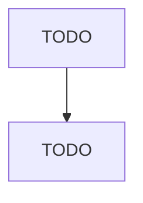

# Research Team: Single Agent vs Pipeline vs Supervisor

> One-line summary: TODO (what you built and the one-sentence finding).

## Problem

Given a topic, produce a short research report with real citations.
Multi-agent systems are popular, but they cost more tokens and are harder to debug.
This project measures when splitting the work actually helps.

## The three systems

| System | Description |
|---|---|
| A. Single agent | One model, one search tool, ReAct loop (baseline) |
| B. Fixed pipeline | Researcher, writer, critic; plain code decides the order |
| C. LLM supervisor | Same three workers; a supervisor model decides who runs next |

Why B exists: it separates the benefit of splitting roles from the benefit of dynamic routing.

### Graphs



## Design

- **Stack:** LangGraph, Groq (models: TODO), search tool (TODO)
- **State schema:** TODO (list the fields and the reducer for each)
- **Workers:** researcher (tools, caps), writer (inputs), critic (rubric)
- **Guardrails:** recursion limit, revision cap, search cap, retry with backoff
- **Key decisions and why:** TODO

## Evaluation

- **Topics:** 5 fixed topics (TODO: list them)
- **Runs per topic:** TODO
- **Metrics:** tokens, wall time, LLM calls, tool calls, failure rate, citation validity, quality score (blind-scored)

### Results

| Metric | A | B | C |
|---|---|---|---|
| Avg tokens | | | |
| Avg time (s) | | | |
| LLM calls | | | |
| Failure rate | | | |
| Citation validity | | | |
| Quality (1-5) | | | |

### Analysis

- Where each system won: TODO
- Where each system lost: TODO
- Cost per quality point: TODO
- When I would use each one: TODO

## Failure modes I hit

1. TODO (symptom, cause, fix)
2. TODO

## How to run

```bash
python -m venv .venv && source .venv/bin/activate
pip install -r requirements.txt
cp .env.example .env   # add GROQ_API_KEY and TAVILY_API_KEY
# TODO: commands to run each system and the eval
```

## Limitations and next steps

- Small topic set and free-tier models, so treat results as indicative
- Next: parallel researchers (Send), checkpointer with human approval, tracing